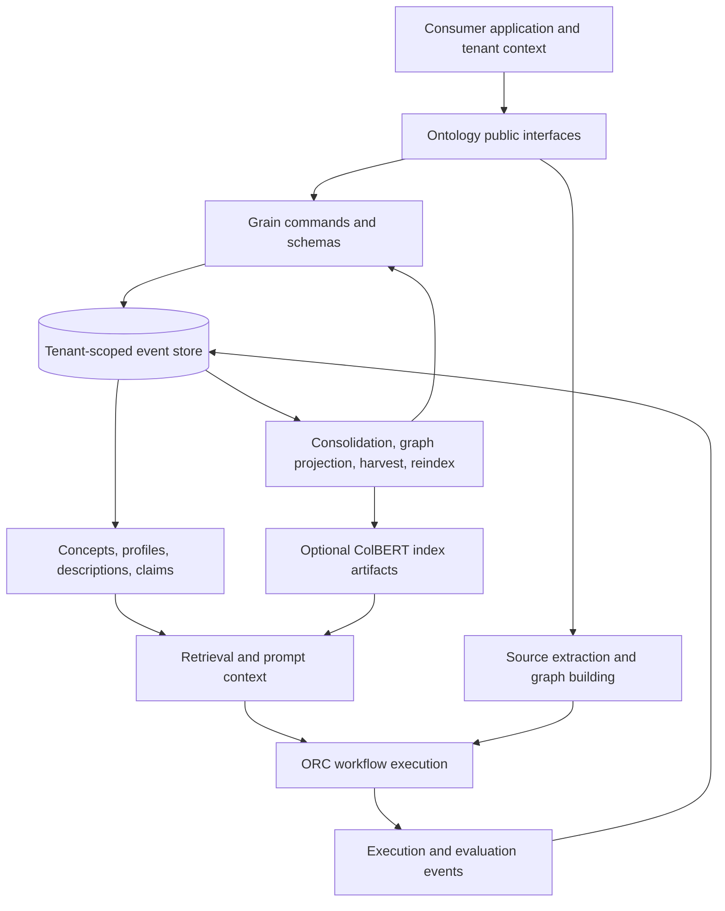
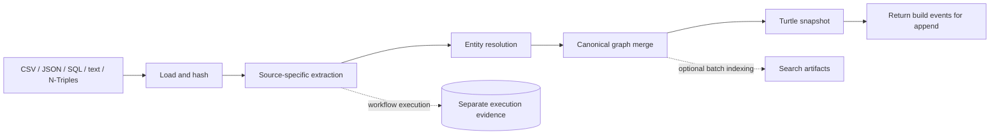
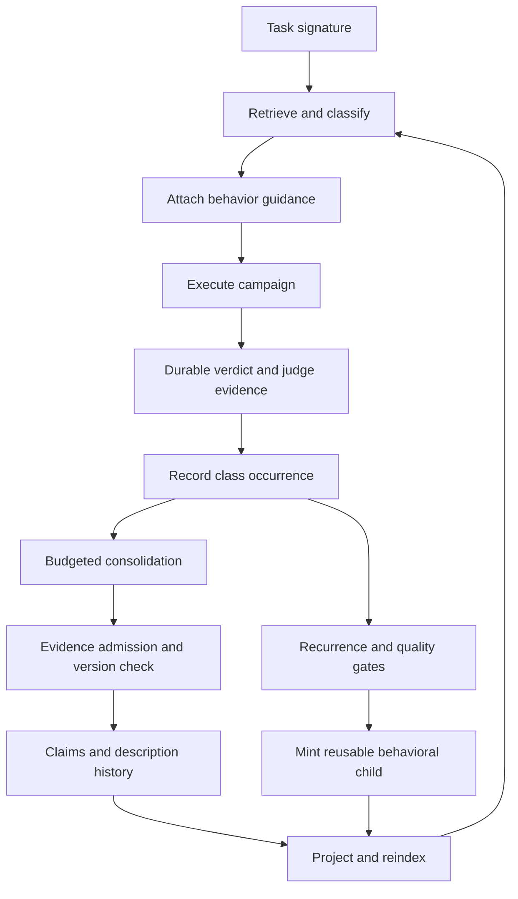

# ORC ontology: architecture and design report

For the proposed standalone-project boundary, see [Extracting ontology from ORC](ontology-extraction-boundary.md). That recommendation keeps graph lifecycle, provenance, import/merge and concept retrieval in the new project, with agent learning and orchestration retained in ORC. The report below documents the current mixed implementation.

Reviewed 18 September 2026. Source: `../orc` at commit `d1f9ae76109f5274bf21dd8e35c41a3e2c0ea0ad`, with a clean worktree when inspected.

ORC's ontology system is an event-sourced semantic memory embedded in a Clojure workflow library. It combines application concept graphs, extraction from external sources, retrieval for prompt construction, and learning from workflow executions. Its most distinctive design is the learning loop: execution evidence becomes versioned descriptions and supported claims, which influence later behavior selection.

The system has substantial safeguards around learned knowledge, but its guarantees differ across subsystems. Custom graph commands enforce lifecycle rules; source builds assemble events around long-running extraction; description learning has explicit evidence admission, concurrency checks, and failure records. These should be understood as separate consistency boundaries.

This report describes the inspected implementation, identifies material differences from its specification, and proposes design priorities. It is a static architecture review with executed Allium checks, not a runtime certification or a complete spec/code conformance audit. No application code was changed. References identify local source files and entry points; test files are coverage evidence, not claims that their tests passed during this review.

## 1. System boundaries

The main package is `orc-ontology`. It includes ontology, the ORC workflow engine, LLM integration, file-store abstraction, and tracing. Consumers supply the event store, tenant context, processor runtime, provider configuration, authentication, and deployment. The ontology component depends on `orc-service` because extraction and reflection execute as ORC workflows. The engine resolves ontology capabilities dynamically, so a minimal engine deployment can omit the ontology component.

DJL embeddings are included. ColBERT is an optional component, resolved lazily. **Generic concept retrieval can operate without ColBERT; Living Description search specifically depends on a built ColBERT description index.** Missing that index returns no description candidates. Package optionality therefore does not imply identical functionality across deployment profiles.

Sources: [package composition](../orc/projects/orc-ontology/deps.edn), [component dependencies](../orc/components/ontology/deps.edn), [public API](../orc/components/ontology/src/ai/obney/orc/ontology/interface.clj), [engine classification integration](../orc/components/orc-service/src/ai/obney/orc/orc_service/core/todo_processors.clj).

The arrows describe logical flows. They do not imply one transaction spanning extraction, provider calls, index creation, and event append.

## 2. Domain model and storage

| Domain object | Identity and meaning | Implementation |
|---|---|---|
| Ontology | UUID identifying an application concept collection, with name, scope and optional base URI | `ontology-created` event and ontology projection |
| Concept | Concept UUID plus URI within an ontology; descriptive fields, provenance and graph adjacency | Concept creation/update events and extraction events feed one projection |
| Relationship | Typed edge between concepts; supported public predicates are broader, narrower, related and composes-into | Relationship events; adjacency sets in concept projection |
| Tree profile | Workflow/tree UUID with strengths, weaknesses, problem mappings and contextual knowledge | Explicit profile recording commands and profile projection |
| Node experience | Patterns aggregated by node type | Node-pattern events and projection |
| Living Description | `(granularity, target identifier)`; current body and append-only version history | Description events and claim-delta events share a projection |
| Claim | Stable event-derived identity, kind, content, support, evidence and status | Deterministic fold of add/support/contradict/edit deltas |
| Source/build | Source UUID and content hash; build UUID, extraction contributions, resolution and snapshot events | Evolutionary builder and source registry |

Living Description granularities include node type, node instance, tree fingerprint, tree class, and behavioral subtree. These distinguish a primitive's behavior, a particular node, an emitted structure, a semantic task family, and a reusable methodology. A `behavior:composes-into` edge bridges behavioral methods to structural shells; the public command explicitly allows this predicate across ontologies.

Static failure, success and problem vocabularies live in Clojure data. Separate EDN resources seed node descriptions, tree classes, behavioral parents and children. Static concept initialization and description corpus seeding are different operations. Re-seeding descriptions can append history even when the projected body is unchanged; it should not be treated as a no-write retry.

This is a Clojure graph and event model with RDF import/export capabilities. The inspected core does not provide a general OWL inference engine or SPARQL query service. TBox/ABox output expresses schema and instances, but does not establish logical entailment or consistency.

Sources: [projections](../orc/components/ontology/src/ai/obney/orc/ontology/core/read_models.clj), [schemas](../orc/components/ontology/src/ai/obney/orc/ontology/interface/schemas.clj), [static vocabulary](../orc/components/ontology/src/ai/obney/orc/ontology/core/static_ontology.clj), [seed loader](../orc/components/ontology/src/ai/obney/orc/ontology/core/seeds.clj), [graph serialization](../orc/components/ontology/src/ai/obney/orc/ontology/core/graph_evolver.clj).

## 3. Custom graph lifecycle

The supported public flow is `create-ontology!`, `create-concept!`, `update-concept!`, and `create-relationship!`, followed by scoped reads. These wrappers dispatch Grain commands. The custom lifecycle handlers require tenant context and validate ontology existence, nonblank descriptive fields, concept URI uniqueness, relationship endpoints, supported predicates, duplicate edges, and broader cycles.

The lifecycle uses command identities to reconcile retries. Ontology, concept and relationship creation can derive their domain identity from `:command/id`; updates record an update identity. Repeating the same logical mutation with the same command ID can avoid another mutation event. This does not establish that arbitrary payload changes under a reused command ID are a valid update operation.

Use ontology-qualified URI lookups. The compatibility lookup returns no concept when a URI is ambiguous across the tenant's ontologies. Tenant isolation and ontology qualification solve different problems: tenants partition access, while ontology IDs disambiguate concepts inside that partition.

The graph is projected from both manual and extracted contributions. However, the projection stores adjacency rather than a complete typed triple relation: unrecognized extracted predicates become generic related adjacency. For applications that need the exact imported predicate or literal, extraction events or exported graph data carry information the generic concept projection does not preserve.

The validation code performs reads before producing mutation events. The inspected custom lifecycle handlers do not attach the claim subsystem's explicit append-time version predicate. Therefore serial validation and retry behavior should not be generalized into a proven concurrent uniqueness guarantee.

Sources: [lifecycle wrappers](../orc/components/ontology/src/ai/obney/orc/ontology/interface.clj), [lifecycle command handlers](../orc/components/ontology/src/ai/obney/orc/ontology/core/commands.clj), [concept projection](../orc/components/ontology/src/ai/obney/orc/ontology/core/read_models.clj), [lifecycle tests](../orc/components/ontology/test/ai/obney/orc/ontology/custom_ontology_lifecycle_test.clj).

## 4. Source-to-ontology construction

The evolutionary interface exposes synchronous batch building and incremental evolution, along with source, concept, canonical mapping and history queries. Use `interface.evolutionary/build-from-sources` and `interface.evolutionary/evolve` for command-backed persistence. The similarly named `interface/build-ontology-from-sources` and `interface/evolve-ontology` call core builders directly and return accumulated events without dispatching the enclosing persistence command. This public API distinction is consequential. The command-backed pipeline is:

1. Load source content and compute SHA-256 hashes. Registration deduplicates against the current ontology's source registry, including duplicate inputs within one submission.
2. Dispatch source-aware extraction. CSV, JSON, text and SQL/SQLite use ORC sheets; the RDF path deterministically imports supported N-Triples. Extraction produces concepts, relationships and, where available, TBox/ABox data and model-call provenance.
3. Resolve entities using type-based blocking, normalized labels/alternate labels, optional embedding similarity, and union-find groups. Pairwise matching generally considers different sources. Canonical selection prefers existing URIs, then shorter URIs, then lexical order.
4. Apply canonical mappings, merge concepts and relationships, deduplicate, and identify schema extensions.
5. Generate a Turtle snapshot and completion summary. Batch builds also attempt configured ColBERT and embedding indexing.
6. Return the accumulated ontology events to the command processor for persistence.

Several distinctions matter for consumers:

- `interface.evolutionary/get-concepts` returns extracted contributions. `interface/get-concepts` returns the common concept projection. A canonicalized snapshot is a third representation. They are not interchangeable views of one normalized graph.
- The resolver supports semantic matching only for concepts already carrying embeddings. The normal batch pipeline generates search embeddings **after** resolution, and the inspected source adapters do not attach embeddings before resolution. Enabling embedding indexing therefore does not activate semantic entity resolution in that normal path.
- Incremental evolution prefers existing URI identities and accepts manually created ontologies. It does not reproduce all of batch building's indexing behavior.
- Snapshot `:triple-count` is computed from counts of classes, properties, individuals, concepts and relationships, rather than by parsing/counting actual RDF statements. Its checksum is a Java string hash formatted as hex, unlike the SHA-256 source hash. Neither should be mistaken for a validated RDF statement count or a cryptographic integrity digest.
- The RDF adapter is a specific N-Triples importer, not a general RDF format ingestion service. Its conversion also does not preserve arbitrary literal statements in the generic concept graph.

Sources: [evolutionary public interface](../orc/components/ontology/src/ai/obney/orc/ontology/interface/evolutionary.clj), [build pipeline](../orc/components/ontology/src/ai/obney/orc/ontology/core/evolutionary_builder.clj), [command persistence boundary](../orc/components/ontology/src/ai/obney/orc/ontology/core/evolutionary_commands.clj), [entity resolution](../orc/components/ontology/src/ai/obney/orc/ontology/core/entity_resolver.clj), [source registry](../orc/components/ontology/src/ai/obney/orc/ontology/core/source_registry.clj), [snapshot generation](../orc/components/ontology/src/ai/obney/orc/ontology/core/graph_evolver.clj).

## 5. Retrieval and context construction

There are two principal retrieval paths.

**Concept retrieval** combines graph spreading activation, dense embedding similarity and optional ColBERT rankings using reciprocal rank fusion. The default embedding model is `sentence-transformers/all-MiniLM-L6-v2`, with 384 dimensions, loaded through DJL/PyTorch and cached in process. Graph search bounds depth and activation; the generic hybrid defaults use depth 2 and decay 0.6. Dense retrieval scans projected embeddings. Batch search shares the ColBERT query operation while graph and embedding work remain per query.

**Living Description retrieval** searches the active `ontology-descriptions` ColBERT index, filters granularity, optionally enriches candidates with strengths/weaknesses and guards, and calls an LLM reranker. The reranker supplies identity, fitness and reasoning; stored candidate content is joined back by document ID. A deterministic domain penalty can reduce fitness using the negative evidence applicable to the candidate. This design keeps model ranking output separate from authoritative stored content.

Reranker failure preserves candidates in ColBERT order with explicit fallback markers and absent fitness. The classifier interprets fallback as uncertainty rather than evidence of novelty. A cold description search returns `[]` and logs that no index exists; it does not synchronously build one. Empty-corpus classification can still generate a provisional class, so startup readiness matters.

Description indexing is asynchronous: description events trigger threshold/time checks, while behavior minting forces a rebuild path. Defaults are 10 description events or 5 minutes; the time condition is checked by the event-driven machinery. Consumers should wire processors and bootstrap existing description corpora. Event persistence and index freshness are separate observable states.

Generic hybrid retrieval has important implementation limits documented in section 8: its graph signal is static and its metadata join is static. It should not currently be assumed to search an arbitrary custom graph consistently across all three signals.

Sources: [retrieval algorithms](../orc/components/ontology/src/ai/obney/orc/ontology/core/retrieval.clj), [graph fusion](../orc/components/ontology/src/ai/obney/orc/ontology/core/graph.clj), [embeddings](../orc/components/ontology/src/ai/obney/orc/ontology/core/embedding.clj), [description search and enrichment](../orc/components/ontology/src/ai/obney/orc/ontology/interface.clj), [reranker](../orc/components/ontology/src/ai/obney/orc/ontology/core/reranker.clj), [reindex processors](../orc/components/ontology/src/ai/obney/orc/ontology/core/todo_processors.clj).

## 6. The learning loop

The design exposes separate retrieval and learning opt-ins. Researcher nodes can enable `:rlm {:auto-classify? true}` to retrieve behavior guidance. A tenant's Living Description flag defaults to false and gates automatic evaluation in the [judge runtime](../orc/components/evaluation/src/ai/obney/orc/evaluation/core/judge_runtime.clj). It is **not a universal write-disable switch**: the inspected ontology threshold, consolidation and harvest handlers do not consult that flag themselves. Processor registration and explicit command access remain operational controls. The public getter's documentation describes a broader writing-side gate than these handlers enforce.

The engine constructs a task signature from instruction, declared inputs/outputs and tools, with optional parent context. Structural classification retrieves tree fingerprints and tree classes; behavioral classification selects reusable methods. Structural outcomes include matching, bundling into a near-matching class, walking down a hierarchy, creating a provisional class, or deferring on uncertainty. The event records the pre-gate ranking used for the decision as well as the gated candidates shown to the model.

Classification is reused within a campaign. A class occurrence is recorded on a qualifying terminal behavior verdict—success, failure or timeout—not merely because classification ran. Cancellation and abandonment do not advance recurrence. Generated patterns and successful campaign outcomes have distinct evidence bases, so merely emitting a shape is weaker evidence than completing a successful campaign with it.

After sufficient relevant events, processors request consolidation. The default threshold is 10; the default budget is 100 consolidations per hour per target type. Reflection gathers a token-budgeted evidence window, records exclusions, and produces either claim deltas or a replacement description body. Failures, budget skips, unchanged claim sets and successful writes have durable outcome representations. A sweep can identify old unanswered requests and record interruption; it runs on later requests for that target and can be invoked for startup/operator recovery.

Tree-profile memory is a related, older path. Consumers explicitly record strengths, weaknesses and problem mappings, and can extract condition/action rules. The former automatic evaluation-event feeder was retired. It would be inaccurate to describe every new evaluation as automatically updating these profiles; current automatic judge-grounded learning flows through Living Descriptions.

Sources: [engine classification and context](../orc/components/orc-service/src/ai/obney/orc/orc_service/core/todo_processors.clj), [task classifier](../orc/components/ontology/src/ai/obney/orc/ontology/core/task_classifier.clj), [occurrence processors](../orc/components/ontology/src/ai/obney/orc/ontology/core/todo_processors.clj), [consolidator](../orc/components/ontology/src/ai/obney/orc/ontology/core/consolidator.clj), [rule extraction](../orc/components/ontology/src/ai/obney/orc/ontology/core/rule_extraction.clj).

### Claims, evidence and promotion

Claims are the atomic learning unit. The model proposes `add`, `support`, `contradict` or `edit`; deterministic projection code applies them. New ordinary claims begin with support 2. Contradiction reduces support and exhaustion retires the claim with retained retirement history. Confidence is derived as `support / (support + 3)`, rather than copied from an LLM assertion.

Ordinary claims need support of at least 5 and post-guard evidence to become validated. Authored claims have an explicit exception: they can enforce without satisfying the ordinary support threshold, but remain subject to contradiction and retirement. An evidence guard distinguishes missing judge evidence, starved input, abstention and unverified explanation. Declared non-judgment evidence bases are handled explicitly rather than presented as judge observations.

Claim-backed retrieval suppression uses validated guards and weaknesses. Candidates can still be visible to the model without qualifying to suppress retrieval. Legacy descriptions retain their body-based enforcement path, so this guarantee must be described with that compatibility exception.

Writes compare the caller's claim-set version with the recorded version and attach an append-time compare-and-set predicate. Pre-detected stale writes produce refusal events. A race occurring after the preliminary read can still return an append conflict without a refusal fact, a narrower observability limitation acknowledged in the command implementation.

Automatic claim consolidation currently selects **tree classes only**. Node-type and node-instance identifiers do not fit the existing claim target schema; tree fingerprints also require graph metadata carried by body events. Other targets therefore retain body consolidation. A universal claim-based Living Description architecture is not yet implemented.

Harvesting is distinct from describing a recurring class. Defaults require at least 10 lifetime occurrences, per-dimension trailing quality of 0.75 over up to 10 scored occurrences, and consistency over 5 scored occurrences at 0.75. Promotion also needs an appropriate behavioral parent and must not already have harvested the class. Successful terminal shape coherence is computed and reported, but currently does not block promotion. Behavioral identities are stable for the same name and parent, with provenance retained.

Sources: [claim command and CAS](../orc/components/ontology/src/ai/obney/orc/ontology/core/commands.clj), [claim fold and confidence](../orc/components/ontology/src/ai/obney/orc/ontology/core/read_models.clj), [evidence guard](../orc/components/ontology/src/ai/obney/orc/ontology/core/evidence_guard.clj), [claim/body routing](../orc/components/ontology/src/ai/obney/orc/ontology/core/consolidator.clj), [harvest](../orc/components/ontology/src/ai/obney/orc/ontology/core/harvest.clj).

## 7. Design assessment

The strongest architectural decisions are the durable evidence trail, explicit distinction between uncertainty and novelty, deterministic claim updates, separation of visible knowledge from enforcing knowledge, and independent retrieval/writing opt-ins. These make the learning loop inspectable and reduce the chance that one model response silently replaces accumulated evidence.

The principal cost is coordination complexity. One component contains concept management, source ingestion, graph export, retrieval, model execution, claim governance, workflow memory, site/action memory and index orchestration. Public interface and core modules are large, and dynamic resolution makes some dependencies invisible to ordinary namespace dependency inspection. Runtime assembly—schemas, processors, indexes, event-store context and feature flags—is part of correctness.

Scalability also varies by path. Dense retrieval and several convenience queries materialize event-derived collections. Entity resolution remains pairwise within type blocks. Description history and retired claims grow with use. Reflection windows and reranker candidates are bounded, but those bounds do not bound the underlying history, index rebuild cost or tenant-wide event scans. No throughput, latency, memory or multi-node recovery measurements were made for this report.

## 8. Material findings and proposed priorities

These are source-grounded findings from the reviewed paths, not an exhaustive defect inventory. Classification is proposed; no code/spec change is included.

**P1 — Async build status does not honor the declared tenant boundary.**

Spec: `SemanticMemory.TenantBoundary` includes every build and query ([ontology.allium:1465](/Users/obneyai/Developer/code2/orc/specs/ontology.allium:1465)). Code: the async `build-registry` is a global atom, and `get-build-progress`, `list-builds`, `await-build!` and registry cleanup accept no tenant context. `list-builds` can return all in-process build entries, including parameters/results. Classification: code gap relative to the stated guarantee. Keep this helper behind a tenant-aware boundary until its registry and reads are scoped. The actual exposure depends on how an application publishes these functions; this review does not claim a deployed network vulnerability.

**P1 — Build failure and restart semantics are weaker than the specified lifecycle.**

Spec: `StartBatchBuild`, `CompleteBuild` and `FailBuild` describe durable running/completed/failed states ([ontology.allium:1212](/Users/obneyai/Developer/code2/orc/specs/ontology.allium:1212)). Code: `build-from-sources` accumulates start, extraction and completion events and returns them after the work finishes; the command handler then returns them for append. A failure before return does not produce the builder's start/failure lifecycle record. Async tracking is a future plus an atom, with an outer ID separate from the builder's ID. It marks any normally returned value completed, including a Grain anomaly map. Classification: code gap. Introduce a durable build identity and terminal state, persist milestones around side effects, and treat anomaly results as failures. ORC sheet execution evidence may survive independently; that does not make the enclosing build restartable.

**P1 — Incremental evolution can export stale or incomplete prior state.**

Spec: `UnifiedManualAndExtractedGraph` and `StartIncrementalBuild` promise evolution of the existing graph ([ontology.allium:1478](/Users/obneyai/Developer/code2/orc/specs/ontology.allium:1478)). Code: `evolve` rebuilds existing concepts from creation and extraction events, omitting `concept-updated`. It passes only the new extraction's TBox/ABox into the next snapshot and does not run the batch embedding/indexing phases. A manually updated description can therefore be current in public reads yet old in the next generated snapshot. Classification: code gap. Rebuild evolution inputs from a canonical current projection, retain prior schema/instance contributions, and give incremental search refresh an explicit contract.

**P1 — Generic hybrid search does not consistently honor ontology scope.**

Spec: `SearchOntologyMemory` and `ScopedMemory` describe scoped graph retrieval ([ontology.allium:1189](/Users/obneyai/Developer/code2/orc/specs/ontology.allium:1189)). Code: `hybrid-search` passes ontology filters to embedding search, but calls `expand-concept-neighborhood` without a graph; that helper defaults to the static graph. `fuse-and-enrich` merges by URI and fetches labels/descriptions only from static concepts. Custom graph edges are absent from that signal, custom result metadata can be nil, and same-URI identities can collapse during fusion. Classification: code gap. Carry ontology-qualified identity through each signal and enrich from the scoped projection.

**P2 — Semantic resolution is implemented but not fed by normal extraction.**

Spec: `ResolveAndMergeBuild` calls for type/similarity resolution ([ontology.allium:1295](/Users/obneyai/Developer/code2/orc/specs/ontology.allium:1295)). Code: semantic matching filters concepts with `:embedding`; normal adapter outputs lack that field, while batch embedding generation runs later. Classification: integration gap between capability and pipeline. Compute comparable embeddings before resolution or explicitly document the default as label/URI resolution. Measure false merges before enabling semantic equivalence broadly.

**P2 — Advertised hybrid weights do not weight RRF contributions.**

Code: `fuse-and-enrich` scales raw graph/embedding scores, then `merge-batches` invokes rank-based RRF without weights. Positive scaling preserves a list's ordering, so it does not change that signal's RRF contribution; setting weight zero is not equivalent to disabling the signal. Classification: API/documentation mismatch. Implement weighted reciprocal contributions or remove the misleading weight contract; use `:signals` for current enable/disable behavior.

**P2 — Graph edges have two update paths with different inverse maintenance.**

Spec: concept updates and relationship operations share a graph model ([ontology.allium:737](/Users/obneyai/Developer/code2/orc/specs/ontology.allium:737)). Code: explicit broader/narrower relationship events update both endpoints, while concept creation/update puts a broader set on the concept without synchronizing the parent's narrower set. Removing broader membership can also disagree with retained relationship-derived adjacency. Classification: model/projection gap. Choose one authoritative edge representation and derive both directions consistently.

**P2 — Specification and integration documentation need reconciliation.**

The current Allium results differ from the checked-in diagnostic baseline (section 9). Also, `ONTOLOGY-MCP.md` advertises an `ontology-server` alias and `ai.obney.orc.ontology-mcp-server.interface`; neither was found in the inspected `deps.edn`, bases, components or development source. Treat the advertised server as unverified documentation, not a shipped integration surface. The separate `mcp-sheet-builder` component generates workflows from MCP tools and is not that ontology server.

For implementation order, first address tenant-scoped durable builds and current-state evolution, then unify retrieval identity and graph representation, then complete semantic resolution and documentation cleanup. Within the component, separate graph storage, ingestion orchestration, retrieval, and learning policy behind smaller interfaces while preserving the existing public facade. Each change should prove behavior through command → event → projection → public query, including failures and retries.

## 9. Verification and evidence limits

Executed against the inspected repository:

| Check | Observed result |
|---|---|
| Git revision/status | Commit recorded above; clean source worktree at initial inspection |
| `allium check specs/ontology.allium` | 69 diagnostics: 7 warnings, 62 informational, no errors |
| `allium analyse specs/ontology.allium` | Same diagnostics; zero process findings |
| `allium check specs` | 12 specifications; 235 diagnostics: 35 warnings, 200 informational, no errors |
| `allium analyse specs` | Same full-suite diagnostics; zero process findings |

The ledger in `specs/COVERAGE.md` reports 150 diagnostics (35 warnings, 115 informational). Current counts include 126 unused-field diagnostics versus the ledger's 38, and 74 unreachable-trigger diagnostics versus 77. This review did not determine whether the difference comes from tool version, specification changes, or both. Zero process findings is not proof of implementation alignment: the source-level findings above remain.

Raw outputs are retained beside this report in `evidence/`. Whole-directory Allium output consists of consecutive JSON documents, one per specification.

Existing tests provide useful verification entry points:

| Area | Tests to use when changing the design |
|---|---|
| Public lifecycle, identity and tenant separation | `custom_ontology_lifecycle_test.clj`, `ontology_id_scoping_test.clj`, `evolutionary_tenant_isolation_test.clj` |
| Source extraction and resolution | `evolutionary_builder_test.clj`, `evolutionary_resolution_regression_test.clj`, `json_ontology_test.clj` |
| Claim lifecycle and evidence | `cc1_claim_store_test.clj`, `cc2_claim_operations_test.clj`, `cc4_evidence_guard_test.clj`, `cc7_claim_status_test.clj` |
| Retrieval and fallback | `retrieval_batch_test.clj`, `rerank_failure_surfacing_test.clj`, `cc9a_enforcement_gate_test.clj` |
| Campaign learning and harvest | `rr19_outcome_recurrence_test.clj`, `rr21_winning_shape_coherence_test.clj`, `el4_harvest_test.clj` |
| Consolidation outcomes | `cc28_failure_visibility_test.clj`, `pr2_exclusions_and_outcome_totality_test.clj` |
| Integration | `orc-service/deterministic_ontology_e2e_test.clj`, `orc-service/real_llm_ontology_builder_e2e_test.clj` |

Test names above are relative to the corresponding component's `test/ai/obney/orc/` namespace tree. The deterministic integration harness substitutes model/index boundaries, so even a passing run would not establish live model quality or native retrieval readiness. Runtime tests, provider calls, native model loading, RDF parser validation and deployed MCP behavior were not executed. The report's conclusions are limited to inspected code paths, specification comparison and the recorded structural checks.
