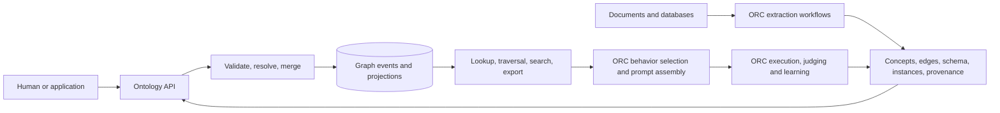

# Extracting ontology from ORC

Design recommendation, 18 September 2026, based on ORC commit `d1f9ae76109f5274bf21dd8e35c41a3e2c0ea0ad`. The source worktree remains unchanged. This document supersedes the broad architecture report as the extraction recommendation; that report remains supporting implementation analysis.

**Extract the concept graph and its lifecycle. Keep the agent's memory, learning policy and execution machinery in ORC.** The new project should work for a caller that has never heard of a sheet, node, tick, campaign, judge or behavioral subtree.

The existing `ontology` component crosses that boundary extensively. Moving the directory or renaming its namespace would carry agent orchestration into the new project. The cut must happen within the shared commands, projections, schemas and public interface.

## Ownership boundary

| Standalone ontology owns | ORC owns |
|---|---|
| Ontologies, concepts, labels, definitions, aliases and stable identity | Task signatures, classification and assignment to task classes |
| Typed relationships, hierarchy, graph validation and traversal | Workflow trees, node types, fingerprints, behavioral composition |
| Source identity, content hashes, contribution provenance | Execution traces, campaign occurrences, judge evidence |
| Canonical mappings, entity resolution and deterministic graph merge | Extractor workflows, model prompts, retries and execution budgets |
| Supported schema/instance representations and RDF import/export | Living Descriptions, learned claims and their support/enforcement policy |
| Concept search and optional graph indexing adapters | Behavior selection, domain penalties, prompt injection and few-shot assembly |
| Tenant-scoped commands, history, queries and graph revision | Consolidation scheduling, behavior harvesting, site/action memory |

“Ontology related” here means managing a model of a domain. An agent can use that model, and agent behavior can itself be represented as domain data, but the ontology project does not assign operational meaning to that data.

For example, ORC may store a concept representing a behavior and link it to other concepts. ORC still owns the behavior's executable body, success criteria, evidence interpretation, recurrence counter and promotion policy. The ontology only knows its identity, descriptive data and declared relationships.

## The integration seam

Use **graph contributions in, graph queries out**. A graph contribution is the result of extraction, not a request to run an agent.

ORC depends on the ontology library. The ontology library has no dependency on ORC, including dynamic namespace resolution, callbacks that execute sheets, or string-valued references to workflow functions. A generic extraction interface inside the ontology core that secretly runs ORC would preserve the coupling; the workflow should call the ontology API after extraction instead.

Keep deterministic parsers and format conversions with ontology where they have no execution-engine semantics. The existing N-Triples importer is a clear candidate. CSV/JSON parsing and SQL schema conversion can also be isolated as format adapters; their current LLM workflows remain in ORC. This preserves ontology construction while separating who discovers candidate knowledge from who commits it.

### Proposed public contract

These are proposed responsibilities, not existing API promises:

| Operation | Contract |
|---|---|
| Create ontology | Tenant-scoped identity, descriptive metadata and graph configuration |
| Create/update concept | Stable identity; validated mutable descriptions and attributes |
| Assert/update relationship | Qualified endpoints, predicate semantics, duplicate and hierarchy validation |
| Import contribution | Validate supplied concepts/edges/schema/instances; resolve under an explicit policy; commit graph changes and provenance |
| Read graph | Qualified concept lookup, neighborhood/hierarchy, source contributions and canonical mappings |
| Search concepts | Return qualified concept identities and scores; optional embedding/index provider |
| Export snapshot | Export a specified graph revision with supported schema and instance data |

Contribution identity and provenance should include tenant, ontology, source, content hash, idempotency key and expected graph revision. Its payload carries concepts, typed edges and supported TBox/ABox data. Producer attribution can carry a name/version, optional model details and an opaque evidence URI. The core does not dereference an ORC trace or interpret a campaign verdict.

Separate **source content identity** from **contribution identity**. One document can legitimately be re-extracted under a new parser, mapping configuration or model. A source hash alone should not permanently suppress every later contribution from those bytes. The exact contribution key and replacement semantics need an explicit contract before implementation.

Imported output must pass the same graph integrity rules as manually authored output. Keeping execution outside does not mean blindly trusting the extractor. Schema validation, endpoint existence, predicate policy, canonical identity, consistency and atomic commit belong inside ontology.

Long-running source loading, extraction, retries, cancellation and workflow progress belong to the caller. A graph import has its own durable transaction/result identity. ORC may maintain a build ID that links several extractions and imports, but that build is not the ontology's execution state machine.

## File-level extraction map

Paths below are relative to [the current ontology namespace](../orc/components/ontology/src/ai/obney/orc/ontology). “Split” means selecting functions and schemas, not moving the existing namespace wholesale.

| Existing file(s) | Disposition |
|---|---|
| `core/source_registry.clj` | Move source identities, hashes, projections and queries; revise deduplication scope and contribution identity explicitly. |
| `core/entity_resolver.clj` | Move normalization, blocking, matching and canonical mapping. Require comparable embeddings as input or through a neutral provider. Keep merge policy explicit. |
| `core/graph_evolver.clj` | Move canonical rewrite, graph merge, schema/instance conversion and snapshot generation. Separate pure operations from persistence. |
| `core/graph.clj` | Move graph construction, supported RDF parsing, traversal and fusion. Audit hardcoded edge policy and unrelated temporal helpers; standard graph semantics belong here, application ranking policy does not. |
| `core/commands.clj` | Split: move ontology/concept/relationship and graph-index mutation handlers only. Leave profile recording, evaluation classification, claim learning, behavior minting, consolidation configuration and action/site operations in ORC. |
| `core/read_models.clj` | Split: move graph lifecycle, concept/edge, source and graph-embedding projections. Leave descriptions, claims, learning counters, profiles, node experience, learned rules and site memory. |
| `core/queries.clj` | Split: retain ontology graph queries; remove static agent vocabulary, profiles, patterns and learning queries. |
| `interface/schemas.clj` | Split by ownership. Remove built-in node types, description granularities, episode references, campaign provenance and judge vocabulary from ontology schemas. |
| `interface.clj` | Replace with a small graph facade. Preserve old ORC entry points through an ORC-owned compatibility facade where needed. Do not load the current facade in the extracted library. |
| `interface/evolutionary.clj`, `core/evolutionary_commands.clj` | Split graph import/history/read APIs from “run extraction and build” APIs. Async build futures/registry stay outside the new ontology project. |
| `core/evolutionary_builder.clj` | Split. Move deterministic N-Triples extraction and contribution assembly/merge support. Keep source workflow registration/execution, trace inspection and end-to-end build coordination in ORC. |
| `core/serialization.clj` | Split. Move concept serialization and standard prefixes. Leave tree/node/profile serialization and agent vocabulary prefixes in ORC. |
| `core/embedding.clj` | Split. Concept text/vector operations may move to an optional search module. Tree-profile and evaluation-feedback embeddings stay in ORC. Remove workflow-based field selection from the ontology path. |
| `core/field_analyzer.clj` | Split. Move useful pure schema introspection/field selection; leave workflow executor wrappers and the LLM-dispatching overload in ORC. |
| `core/colbert_indexer.clj` | Extract concept document construction and adapt index operations behind a search provider. Do not retain resolution of `ai.obney.orc.colbert.interface` in the standalone project. |
| `core/retrieval.clj` | Split. Move scoped graph/concept retrieval and fusion. Leave similar-tree search, success/failure guidance, self-patterns and prompt-context formatting in ORC. Remove default dependence on static agent vocabularies. |
| `core/classifier.clj`, `core/task_classifier.clj` | Stay in ORC: evaluation-to-failure mapping and task/behavior classification. |
| `core/consolidator.clj`, `core/evidence_guard.clj`, `core/evidence_projection.clj` | Stay in ORC: execution-derived learning, reflection workflows, judge evidence interpretation and trace expansion. |
| `core/harvest.clj`, `core/domain_penalty.clj`, `core/reranker.clj` | Stay in ORC: behavior promotion, learned suitability policy and workflow-backed semantic reranking. Generic ranking can be extracted separately if later needed. |
| `core/rule_extraction.clj`, `core/field_analyzer_workflow.clj` | Stay in ORC as workflows. Pure format/schema helpers may be factored out. |
| `core/todo_processors.clj` | Stay in ORC. Extract only a new generic graph-change indexing handler if required; do not transfer the existing learning/description subscriptions. |
| `core/static_ontology.clj`, `core/seeds.clj`, `resources/seeds/*` | Stay in ORC as agent-domain vocabulary and corpus data. A generic ontology import operation can load them when ORC requests it. |
| `sheets/*`, including `model_pinning.clj` | Stay in ORC as workflow definitions and workflow model configuration. Move selected pure parsing/serialization helpers out first if useful. |

Evidence for the hidden dependencies: [component dependencies](../orc/components/ontology/deps.edn), [field analyzer](../orc/components/ontology/src/ai/obney/orc/ontology/core/field_analyzer.clj), [builder](../orc/components/ontology/src/ai/obney/orc/ontology/core/evolutionary_builder.clj), [public interface](../orc/components/ontology/src/ai/obney/orc/ontology/interface.clj), [schemas](../orc/components/ontology/src/ai/obney/orc/ontology/interface/schemas.clj). The field analyzer can dynamically load a workflow despite having no ORC engine in its top-level require list; dependency auditing must include executable strings and dynamic calls.

## Decisions at the ambiguous edges

**Living Descriptions and claims stay in ORC for this extraction.** Generic descriptions, provenance and revision history belong to ontology, but the current claim system encodes capabilities, strengths, weaknesses, guards and representative uses; its evidence includes `[sheet-id, tick-id]` episodes and campaign verdicts. Its confidence and validation policies determine whether a behavior may be recommended or suppressed. Renaming those fields would not turn it into a general ontology assertion system. A future evidence-backed assertion module is a separate design, not a prerequisite for extracting the graph.

**Agent vocabularies remain caller-owned data.** Failure, success, problem type, node type, tree class and behavioral subtree should not be the standalone library's closed `scope` enum. Use caller-defined vocabulary/type identifiers. ORC can import its vocabulary without every ontology consumer acquiring those domain assumptions.

**Predicate mechanics belong to ontology; agent-specific meaning belongs to ORC.** SKOS hierarchy behavior can be built in. `behavior:composes-into` should be registered or declared by ORC as a typed relationship, including any permitted cross-ontology endpoints. The core can enforce a declarative predicate policy without knowing what a behavior or structural shell is. Always qualify endpoints by ontology as well as URI.

**Search belongs with ontology when it retrieves graph entities.** Embedding and ColBERT implementations are optional adapters. Task fitness, successful-tree selection, enforcement of learned guards and prompt formatting remain outside. The present ORC-hosted ColBERT component can initially be used by an ORC-owned adapter; the ontology project must not depend on that component. Moving ColBERT into its own project is not required to establish this boundary.

**Grain may stay.** Event sourcing, tenant isolation, command validation and projections are persistence concerns, not agent orchestration. Retain Grain initially; separating it too would enlarge the migration without sharpening the requested domain boundary. Keep its adapter conceptually separate from pure graph operations. The default dependency graph should contain no ORC engine, evaluation, agent browser, tracing package or model workflow. Optional DJL/search dependencies can sit outside the basic graph package.

## Migration plan

1. **Freeze ownership and split the specification.** Extract custom lifecycle, qualified identity, relationships, source contribution, resolution, graph retrieval and snapshot obligations from `specs/ontology.allium`. Keep classification, descriptions, claims, recurrence, consolidation, harvest and prompt-related contracts in an ORC memory specification. Rewrite the current build rules around contribution imports; preserve workflow-build behavior in ORC rather than silently dropping it.
2. **Create a standalone graph package from selected code.** Split schemas/commands/projections before moving the facade. Remove built-in agent scopes and static vocabulary fallback. Keep old persisted event names readable through a compatibility adapter; package names need not dictate historical event names.
3. **Establish the contribution API.** Refactor ORC's existing builders to produce neutral data and call the graph package. Provide deterministic N-Triples import without ORC. Put long-running build tracking and extraction failures in ORC's build coordinator.
4. **Switch ORC consumers to the public graph boundary.** ORC retains learning history and executable behavior bodies, referring to graph concepts by qualified identity. Its projector can publish descriptive updates and relationships through public commands. Its retrieval adapter joins graph results with ORC-owned descriptions and evidence when needed.
5. **Migrate data deliberately.** For the first code extraction, retain the existing event store and replay-compatible event schemas where practical. A later separate store can use a snapshot plus revision watermark and an explicit change handoff. Do not copy mixed learning events into a new ontology store merely because their namespace begins `:ontology/`. Rebuild graph indexes from graph data; leave the behavior-description index with ORC.
6. **Prove independence and compatibility.** Run graph lifecycle/import/query tests on a classpath with no ORC components. Run the ORC integration tests against the extracted library to establish that extraction and learning still work through the new boundary.

Required boundary proofs are: tenant isolation; same URI in different ontologies; retry-safe imports; conflict detection; equivalent graph results from manual and imported changes; hierarchy inverse consistency; snapshot/replay preservation; optional-search absence; and no ORC event subscriptions or runtime namespace resolution in the standalone package. An ORC fixture should then execute an extraction workflow, commit its contribution, and retrieve the graph through the new library. These are proposed migration gates, not tests executed in this design review.

The earlier review identifies issues directly relevant to this cut: custom graph search currently falls back to static traversal, canonicalized snapshots differ from the common projection, incremental evolution omits concept updates, and normal semantic resolution lacks pre-resolution embeddings. Fix these at the new graph/import boundary; preserving them as accidental public contracts would make extraction harder to finish cleanly.

The extraction is complete when an ordinary application can create, import, evolve, search and export its ontology without loading agent orchestration—and ORC can still use that library as one of its dependencies.
